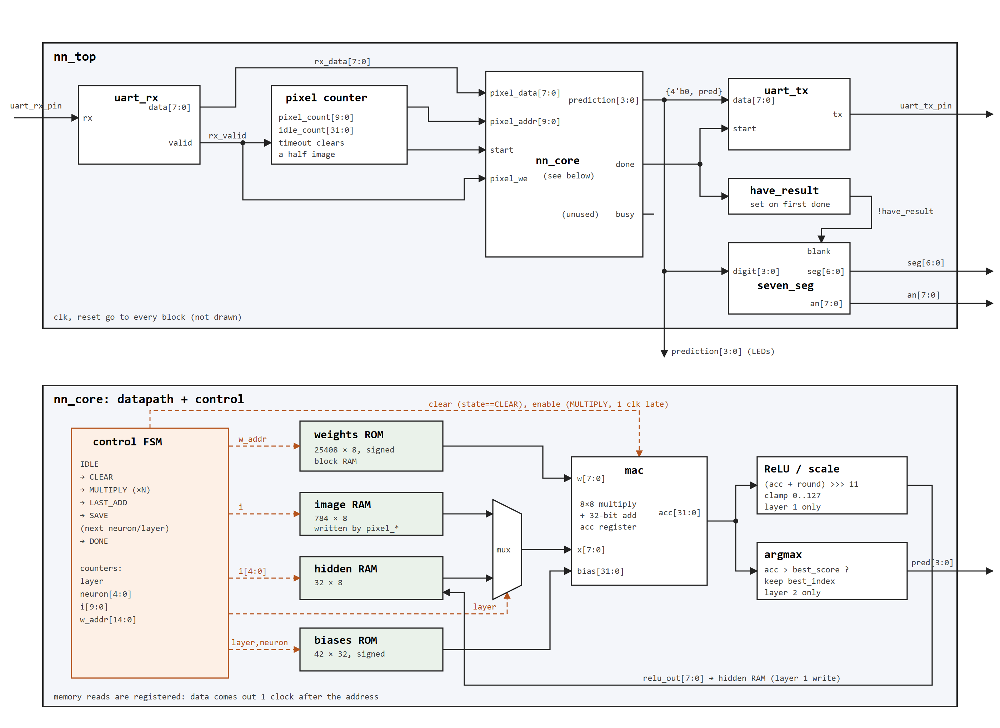

# hardware-accelerator
SystemVerilog digit recognizer

Work in Progress

# How does it work

## Input
- 28 x 28 pixel image gets sent over UART by a computer to the FPGA
- one byte per pixel so 784 bytes per image, each pixel is 0 (no ink) to 127 (full ink)
- if the computer stops halfway through an image, the FPGA times out and throws the partial image away

## Output
- the digit with the highest score wins (argmax)
- the digit gets sent back over UART and shows up on the right most 7-seg display
- display stays blank until the first answer

## The network
- a 784 -> 32 -> 10 network (784 total pixels, 32 hidden neurons, 10 digits)
- two-layer network, the hidden layer spots simple parts like a horizontal bar at the top, loop at the bottom, diagonal stroke, etc.
- the hidden layer has 32 detectors which spot one part each
- layer 2 has 10 detectors, one for each digit, with weights for each detector
- layer 2 doesn't look at pixels, it looks at the 32 part scores from layer 1, only 32 weights
- top bar + diagonal = 7, two loops = 8, etc.

## Scoring
- score = pixel0*weight0 + pixel1*weight1 + ... + pixel783*weight783 (hence need for a MAC)

## Bias
- Bias sets how much evidence a neuron needs before it "turns on"
- for example, a neuron detects a horizontal bar on the top. lots of digits put ink up there, like a 9. a 9 doesn't have a horizontal bar so you want it to only say its a horizontal bar when it really thinks so.

## ReLU
- ReLU (rectified linear unit) purpose is to say if the part (layer 1) isn't here, just report as 0. Without it a no part could be a strong signal in layer 2 which muddles the decision.

# Why it's a hardware accelerator
- it is built for this exact purpose of multiply-add, a normal cpu would need several instructions per multiply-add while this can do this one per clock.
- not faster than a laptop cpu though, a laptop runs way faster clocks and does many multiply-adds at once. more MACs in parallel would be the next step

# Hardware
- one MAC that gets reused for every neuron, a state machine steps through every pixel and weight one per clock
- weights and biases are stored in block RAM, 25408 weights total (32 x 784 + 10 x 32)
- everything is 8-bit signed integers instead of decimals, keeps the multiplier small and barely loses accuracy
- accumulator is 32 bits so adding up 784 products can't overflow
- after layer 1 the score gets scaled back down and clamped to 127 so it fits back into the same 8-bit MAC for layer 2

# Numbers
- 25,536 clock cycles per image, about 0.26 ms at 100 MHz
- sending the image over UART takes about 68 ms at 115200 baud, so UART is the bottleneck not the math
- 392 LUTs, 224 flip-flops, 8.5 block RAMs on the Artix-7 100T

# Testing
- testbenches in `tb/`, run one with `tb\run_sim.bat <name>` (needs Vivado)
- `seven_seg_tb` checks every digit and the blank
- `nn_core_tb` checks every hidden value, score and prediction against the python model on 50 images
- `nn_top_tb` acts like the computer, sends images over UART and checks the digit that comes back
